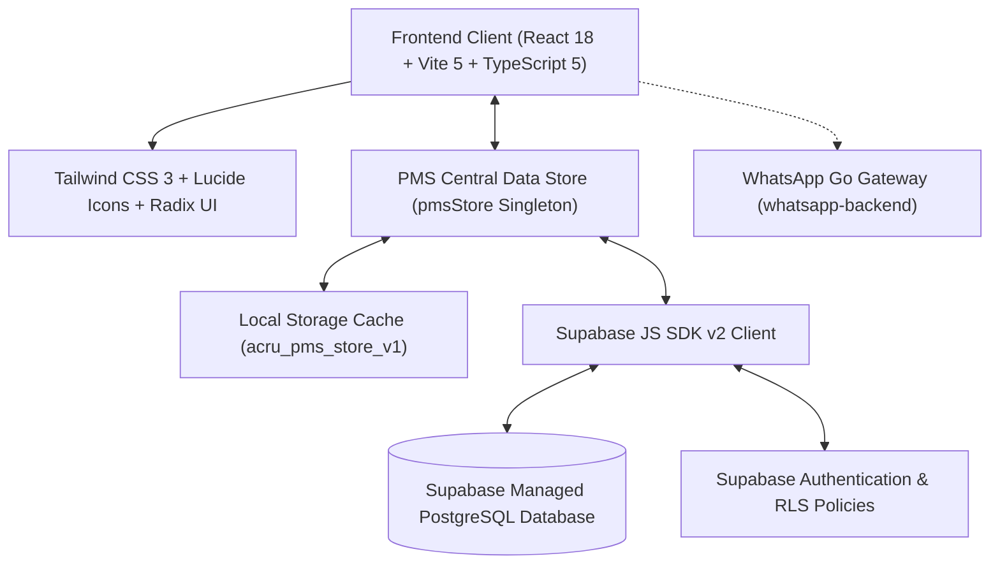
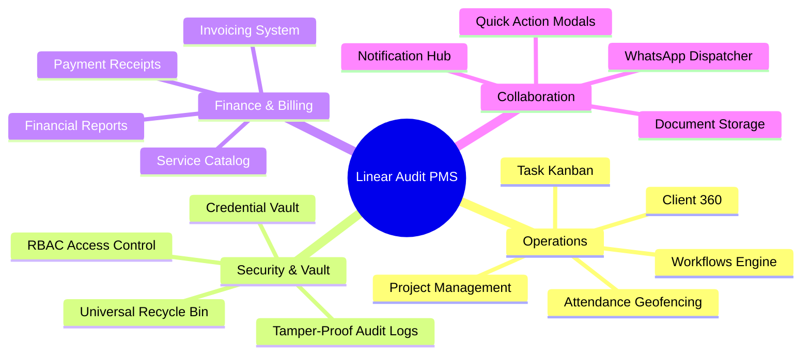
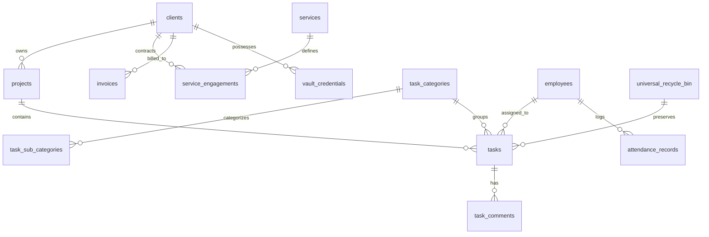

# Linear Audit PMS — Comprehensive System Report & Architecture Manual

```
  ██╗     ██╗███╗   ██╗███████╗ █████╗ ██████╗      █████╗ ██╗   ██╗██████╗ ██╗████████╗
  ██║     ██║████╗  ██║██╔════╝██╔══██╗██╔══██╗    ██╔══██╗██║   ██║██╔══██╗██║╚══██╔══╝
  ██║     ██║██╔██╗ ██║█████╗  ███████║██████╔╝    ███████║██║   ██║██║  ██║██║   ██║   
  ██║     ██║██║╚██╗██║██╔══╝  ██╔══██║██╔══██╗    ██╔══██║██║   ██║██║  ██║██║   ██║   
  ███████╗██║██║ ╚████║███████╗██║  ██║██║  ██║    ██║  ██║╚██████╔╝██████╔╝██║   ██║   
  ╚══════╝╚═╝╚═╝  ╚═══╝╚══════╝╚═╝  ╚═╝╚═╝  ╚═╝    ╚═╝  ╚═╝ ╚═════╝ ╚═════╝ ╚═╝   ╚═╝   
                               Practice Management System (PMS)
```

---

## 1. Executive Summary & System Vision

**Linear Audit PMS** is an enterprise-grade Practice Management System purpose-built for Chartered Accountancy (CA) firms, statutory audit practices, corporate tax consultancies, and multi-disciplinary financial legal advisory institutions.

Traditional CA firms operate across disjointed silos: spreadsheets for GST/Income Tax deadlines, email threads for client KYC documents, sticky notes for portal passwords, and messaging apps for internal task allotment. **Linear Audit PMS** consolidates these fragmented workflows into a unified, high-performance web platform featuring:

- **End-to-End Client Lifecycle (Client 360°)**: Complete master entity management, PAN/GSTIN validation, bank accounts, authorized signatories, and engagement tracking.
- **Hierarchical Deliverables Engine**: Practice-wide categorization into custom audit/tax categories, dynamic sub-groups, deliverables, tasks, and multi-level subtasks.
- **Workflow Automation & Stage Kanban**: Multi-milestone execution pipelines with automated task cascading and progress calculations.
- **Zero-Mock Production Data Architecture**: Absolute cloud-authoritative synchronization with Supabase PostgreSQL, ensuring zero phantom/resurrected records across multiple browsers or devices.
- **Military-Grade Portal Credential Vault**: Client government and banking credentials protected with AES-256 encrypted fields, password history versioning, and auditable access tracking.
- **Omni-Channel Client Dispatch**: Context-aware WhatsApp messaging directly from tasks and workflows with smart tag interpolation.
- **Adaptive Mobile Architecture**: Desktop side-nav that seamlessly transforms into a touch-optimized slide-over drawer on mobile viewports (`100dvh`).

---

## 2. Technology Stack & Design System



### Core Architecture Components

| Layer | Technologies | Key Responsibility |
|---|---|---|
| **UI Framework** | React 18.3, TypeScript 5.7, Vite 5.4 | High-performance single page application (SPA) with typed business contracts. |
| **Styling & Theme** | Tailwind CSS 3.4, Tailwind Animate, Radix UI Primitives | Custom-tailored dark indigo sidebar (`#16172d`), pristine white slate canvas (`#fcfcff`), and interactive micro-animations. |
| **Routing** | React Router DOM v6.28 | Declarative routing with Super Admin / Employee View-Only guards and query param synchronization. |
| **State & Business Engine** | Custom Reactive Store (`pmsStore`) | In-memory singleton with subscriber pattern (`Set<() => void>`), optimistic mutations, and two-way reconciliation. |
| **Persistence & Database** | Supabase PostgreSQL 15+ | 20+ relational tables with foreign keys, cascading constraints, indexes, and pure DDL without hardcoded seeds. |
| **Document Generation** | jsPDF 2.5, jsPDF-AutoTable 3.8, XLSX 0.18 | Direct client-side PDF invoice generation, audit working paper exports, and Excel spreadsheets. |
| **Security & Privacy** | Supabase Auth + In-Memory RBAC + Geolocation API | Role-based permission checks (`isSuperAdmin`, `isEmployeeRestricted`) and GPS geofenced attendance tracking. |

---

## 3. Core Modules & Functional Capabilities



### 3.1. Executive Dashboard & Real-Time KPIs
- **Four Core KPI Cards**: Displays Active Clients, In-Progress Projects, Active Deliverable Tasks, and Monthly Billed Revenue with month-over-month growth indicators.
- **Workflow Pipeline Distribution**: Visual progress breakdown across active service workflows (Incorporation, GST Filings, Audits).
- **Recent Deliverables Matrix**: Real-time list of pending deliverables showing priority badges, due dates, allotted clients, and primary assignees.
- **Quick Action Triggers**: Instant modal launches for new client onboarding, project initiation, task creation, or invoice drafting directly from the dashboard.

### 3.2. Client 360° Management & Master Directory
- **Comprehensive Master Profile**: Stores Legal Business Name, Trade Name, Constitution (Private Limited, LLP, Partnership, Sole Proprietorship, Trust, Individual), PAN, GSTIN, CIN/LLPIN, and Incorporation Date.
- **Relationship Manager Allotment**: Links client accounts directly to dedicated Practice Directors or Senior Managers.
- **Multi-Contact Directory**: Sub-entity directory of client key personnel (Promoter, Director, CFO, Accounts Manager) with official email and WhatsApp phone numbers.
- **Banking & Statutory Records**: Secure storage of bank account details (IFSC, Account Number, Bank Name, Branch) and registered office addresses.
- **Client 360° Overview Hub**: Unified detail view aggregating active projects, allotted tasks, issued invoices, payment history, stored documents, and active engagements in a single tabbed cockpit.

### 3.3. Project Lifecycle & Deliverables Tracking
- **Service Engagement Linking**: Projects are tied to specific contracted services (e.g., *Statutory Audit FY 2025-26* or *Monthly GST Return Filing*).
- **Target Milestones & Deadlines**: Configurable start dates, target completion deadlines, and fee budgets.
- **Automatic Progress Calculation**: Project progress percentage is dynamically computed from the completion ratio of its child deliverable tasks.
- **Status Lifecycle**: Tracks projects across `Planning`, `In Progress`, `Under Review`, `On Hold`, and `Completed`.

### 3.4. Multi-Dimensional Task Management & Kanban Engine
- **Three Strategic Perspectives**:
  1. **Category Wise (Level 1 Categories -> Level 2 Sub-groups Kanban)**: High-level overview of practice categories (*Taxation & Compliance*, *Audit & Assurance*, *Corporate & Secretarial*, etc.). Clicking any category opens its Level-2 Kanban board where columns represent practice sub-groups (*Direct Tax*, *GST*, *Tax Audit*, *Entity Formation*).
  2. **Employee Wise Kanban**: Columns correspond to team members, showing each staff member's workload, active deliverables, and overdue tasks.
  3. **Status Wise Kanban**: Standard operational board with stages: `Open` -> `To Do` -> `In Progress` -> `Approval Pending` -> `Hold` -> `Under Review` -> `Completed`.
- **Searchable Multi-Employee Assignment**: Assign one or more team members to a task with a searchable employee dropdown selector.
- **Direct Client Allotment**: Link tasks directly to a client with dedicated client code indicators (`TSK-012 • Client: ROHTI`).
- **Subtask Hierarchy & Checklist**: Tasks support nested subtasks with independent completion checkboxes.
- **Clipboard (Cut, Copy, Paste, Move)**: Multi-select tasks and move or copy them across categories or sub-groups.
- **Recycle Bin Protection**: Deleted tasks are preserved in the 25-day recovery recycle bin instead of being permanently wiped.

### 3.5. Service Catalog & Practice Engagements
- **Standardized Service Master**: Catalog of standard firm offerings with service code (`SRV-GST-01`), billing frequency (*One-Time*, *Monthly*, *Quarterly*, *Annually*), and base pricing.
- **Client Engagements (Contracts)**: Associates services with clients, defining contract start/end dates, agreed professional fees, and billing cycles.

### 3.6. Dynamic Workflow Automation & Stage Kanban Board
- **Hierarchical Workflow Blueprint**:
  $$\text{Workflow Template} \longrightarrow \text{Milestones} \longrightarrow \text{Stages} \longrightarrow \text{Sub-stages} \longrightarrow \text{Checklist Tasks}$$
- **Interactive Stage Kanban**: Visual drag-and-drop board for complex workflows (such as *Private Limited Company Incorporation*):
  - Stage 1: Name Approval (RUN/SPICe+ Part A)
  - Stage 2: Digital Signature Certificates (DSC) & DIN
  - Stage 3: SPICe+ Part B, eMOA, eAOA Drafting & Submission
  - Stage 4: Certificate of Incorporation (COI), PAN & TAN Issuance
  - Stage 5: Post-Incorporation Bank Account & Commencement of Business (INC-20A)
- **Automatic Task Synchronization**: Advancing workflow milestones automatically updates linked client project deliverables.

### 3.7. WhatsApp Business Automation
- **Dynamic Tag Interpolation**: Pre-configured message templates that dynamically inject contextual task and client variables:
  - `{client_name}`, `{task_title}`, `{project_name}`, `{due_date}`, `{status}`
- **Context-Aware Client Resolver**: WhatsApp dialog automatically resolves allotted client details from the task, project, or manual selector.
- **Direct Web & Mobile URL Generation**: Generates official `https://wa.me/{phone}?text={encoded_message}` links that launch the native WhatsApp app on iOS/Android or WhatsApp Web on desktop with pre-filled text.
- **Automated Reminder Templates**:
  - Task Allocation Notification
  - Deliverable Due Reminder
  - Workflow Milestone Progress Update
  - General Notice / Document Request

### 3.8. AES-256 Credential Vault & Portal Secrets Manager
- **Secure Password Vault**: Dedicated repository for sensitive government and portal logins:
  - Income Tax e-Filing Portal, GST Portal, MCA / ROC Portal, TRACES, DGFT, EPFO / ESIC, and Client NetBanking.
- **Category & Client Partitioning**: Credentials organized by client and category with masked view toggle (`••••••••`).
- **Password Version History**: Tracks previous passwords, change timestamps, and modifier usernames.
- **Audit Logging**: Every password access, reveal, copy, edit, or deletion triggers a permanent `vault_audit_logs` entry recording the employee name, action, and timestamp.

### 3.9. Financial Operations, Invoicing & Payment Tracking
- **Professional Tax Invoices**: Generate GST-compliant invoices with unique invoice numbers (`INV-2026-001`), line items, SAC codes, taxable amounts, and CGST/SGST/IGST breakdowns.
- **Payment Collection & Receipts**: Record full or partial payments across Cash, Bank Transfer, NEFT/RTGS, UPI, and Cheque with transaction reference numbers.
- **Client-Side PDF Invoicing**: Clean invoice PDF generation with company header, banking details, client billing address, and authorized signature section.
- **Aging & Outstanding Badges**: Visual indicators for `Paid`, `Partially Paid`, `Due`, and `Overdue` invoices.

### 3.10. Team Structures & Multi-Tier Staff Directory
- **Standard Six-Tier CA Hierarchy**:
  1. `DIR` (Managing Partner / Director — Level 1)
  2. `HEAD` (Practice Head — Level 2)
  3. `MGR` (Senior Manager / Supervisor — Level 3)
  4. `SR_CONS` (Senior Consultant — Level 4)
  5. `ASSOC` (Associate Consultant — Level 5)
  6. `TRAINEE` (Articled Assistant / Trainee — Level 6)
- **Cross-Functional Teams**: Organize staff into specialized practice pods (*Direct Tax Team*, *Statutory Audit Team*, *Corporate Restructuring Pod*).

### 3.11. Super Admin Governance & View-Only Restrictions
- **Strict Role-Based Access Control (RBAC)**:
  - **Super Admin / Practice Director**: Full administrative control across the firm, including firm settings, employee onboarding, invoice deletion, and vault master override.
  - **Staff / Articled Assistant (View-Only Restrictions)**: Staff members can only view tasks, projects, workflows, and clients assigned to them. Administrative actions (creating categories, altering firm billing, or managing admins) are strictly hidden and disabled.

### 3.12. Office Geofence Attendance & Shift Tracking
- **GPS Coordinates & Radius Validation**: Firm admin defines office latitude, longitude, and permissible geofence radius (e.g., 200 meters).
- **Haversine Distance Algorithm**:
  $$d = 2r \arcsin\left(\sqrt{\sin^2\left(\frac{\Delta\phi}{2}\right) + \cos(\phi_1)\cos(\phi_2)\sin^2\left(\frac{\Delta\lambda}{2}\right)}\right)$$
- **Check-in / Check-out Validation**: Prevents remote attendance spoofing by verifying employee device coordinates against firm geofence parameters.

### 3.13. Document Management & Digital Workpapers
- **Organized Folder Structures**: Pre-structured document trees:
  - `/clients/kyc` (PAN cards, GST registration certificates, MOA/AOA deeds)
  - `/audits/statutory` (CARO checklists, balance sheet notes, bank confirmations)
  - `/tax/returns` (ITR acknowledgments, Form 3CD audit reports, computations)
  - `/gst/monthly` (GSTR-1, GSTR-3B filed acknowledgments, GSTR-2B reconciliations)
- **Metadata Tagging**: Documents store file type, byte size, uploader identity, creation timestamp, and linked entity IDs.

### 3.14. Universal Recycle Bin (25-Day Safe Recovery)
- **Soft-Delete Architecture**: Items deleted across the platform (tasks, categories, clients, workflows, documents) are stored in `universal_recycle_bin` with a 25-day countdown.
- **One-Click Restoration**: Restores the entity with all its metadata, subtasks, and associations intact, immediately re-inserting it into the Supabase database.
- **Permanent Deletion Override**: Super Admins can permanently purge items to clear database space.

### 3.15. Analytical Reports, Financial Forecasting & Export Engine
- **Productivity & Performance Metrics**: Monthly deliverable completion volume, team workload balancing, and overdue resolution rates.
- **Billing & Revenue Analytics**: Billed revenue vs. cash collected, outstanding receivables aging, and service revenue contributions.
- **Export Capabilities**: One-click export of data tables to Microsoft Excel (`.xlsx`) or print-ready PDF reports.

---

## 4. Database Architecture & Supabase DDL Schema

The system uses a pure DDL relational model in PostgreSQL (Supabase) without mock or auto-filling seed data.



### Core Schema Entity Summary

| Table Name | Primary Key | Key Foreign Keys | Purpose |
|---|---|---|---|
| `clients` | `UUID` | `created_by -> employees(id)` | Master client entity (PAN, GSTIN, legal name, email, phone). |
| `client_contacts` | `UUID` | `client_id -> clients(id)` | Key contacts and authorized signatories. |
| `client_bank_accounts` | `UUID` | `client_id -> clients(id)` | Bank accounts, IFSC, branch information. |
| `services` | `UUID` | — | Firm service catalog with service codes, frequencies, and fees. |
| `service_engagements` | `UUID` | `client_id`, `service_id`, `relationship_manager_id` | Contractual engagements linking clients to firm services. |
| `projects` | `UUID` | `client_id`, `service_engagement_id` | Delivery projects with deadlines and completion metrics. |
| `task_categories` | `UUID` | — | Practice categories (*Taxation*, *Audit*, *Corporate*). |
| `task_sub_categories`| `UUID` | `category_id -> task_categories(id)` | Practice sub-groups (*Direct Tax*, *GST*, *Tax Audit*). |
| `tasks` | `UUID` | `project_id`, `category_id`, `sub_category_id`, `client_id`, `parent_task_id` | Deliverables and subtasks with priorities, statuses, and assignees. |
| `workflow_templates` | `UUID` | `service_id -> services(id)` | Structured service execution templates with JSON milestone hierarchies. |
| `invoices` | `UUID` | `client_id`, `project_id` | Invoices with GST calculations and status badges. |
| `payments` | `UUID` | `invoice_id`, `client_id` | Payment receipts with payment modes and transaction IDs. |
| `employees` | `UUID` | `designation_id`, `team_id`, `role_id` | Staff profiles, designations, roles, and status. |
| `roles` | `UUID` | — | System roles with permissions and `role_code` (`SUPER_ADMIN`, `ADMIN`, etc.). |
| `vault_credentials` | `UUID` | `client_id -> clients(id)` | Sensitive portal logins and encrypted passwords. |
| `vault_audit_logs` | `UUID` | `credential_id`, `performed_by -> employees(id)` | Audit trail of vault credential interactions. |
| `universal_recycle_bin`| `UUID` | — | 25-day soft delete recovery repository. |
| `attendance_records`| `UUID` | `employee_id -> employees(id)` | GPS-verified clock-in/out records. |

---

## 5. Data Engine, 2-Way Sync & Persistence Protocol

### Single Source of Truth Architecture

To prevent multi-browser sync discrepancies and data resurrection bugs:

1. **Supabase is Authoritative**: When `loadAllFromSupabase()` executes, the remote database state directly governs local state. If Supabase reports 0 tasks or 0 workflows, local arrays are cleared rather than preserving stale local storage caches.
2. **Recycle Bin Id Isolation**: The store cross-references `universal_recycle_bin` using `item.item_id`, `item.id`, and `item.code`. Any entity currently in the recycle bin is strictly excluded from active views across all devices.
3. **Reactivity & Focus Wakeup**:
   - Constructor registers listeners on `window.focus` and `document.visibilityState === "visible"`.
   - When a user deletes a task in Brave and switches to Microsoft Edge, Edge's focus event triggers an automated re-fetch from Supabase, keeping both browsers synchronized without manual refreshes.
4. **Offline Draft Protection**: Genuinely unsaved offline drafts created within the last 15 seconds without a server UUID are safely retained and pushed to Supabase upon connection recovery.

---

## 6. Adaptive User Interface & Mobile Architecture

```
Desktop Viewport (>= 1024px)
┌──────────────┬────────────────────────────────────────────────────────┐
│ Dark Indigo  │ Top Navigation Header (Search, Date, Notifications)    │
│ Sidebar      ├────────────────────────────────────────────────────────┤
│              │ Main Content Canvas                                    │
│ [248px]      │ [Level 1 Categories | Kanban Boards | Data Tables]     │
│ (Collapsible)│                                                        │
└──────────────┴────────────────────────────────────────────────────────┘

Mobile Viewport (< 1024px)
┌───────────────────────────────────────────────────────────────────────┐
│ [≡] Linear Audit PMS                  [🔍] [🔔] [Avatar] [+]          │
├───────────────────────────────────────────────────────────────────────┤
│                                                                       │
│ Full-Width Main Content Canvas (Edge-to-Edge p-0 / px-3.5)            │
│ [Responsive Cards, Horizontal Touch-Scroll Kanban Boards]             │
│                                                                       │
└───────────────────────────────────────────────────────────────────────┘
  ▲
  │ (Tap Hamburger Button [≡])
┌─┴────────────────────────────┐
│ Slide-Over Drawer [300px]    │
│ ┌──────────────────────────┐ │
│ │ Linear Audit PMS     [X] │ │
│ ├──────────────────────────┤ │
│ │ • Dashboard              │ │
│ │ • Client 360°            │ │
│ │ • Projects               │ │
│ │ • Tasks (Badge)          │ │
│ │ • Workflows (Dropdown)   │ │
│ │ • Finance & Invoices     │ │
│ │ • Credential Vault       │ │
│ ├──────────────────────────┤ │
│ │ User Profile Capsule     │ │
│ └──────────────────────────┘ │
└──────────────────────────────┘
```

### Mobile Optimizations

- **Slide-Over Drawer**: Replaces the permanent desktop sidebar on viewports below `1024px`. Automatically closes upon navigating or tapping outside.
- **Dynamic Viewport (`h-[100dvh]`)**: Prevents UI clipping and scroll bouncing caused by mobile address bars in Safari and Chrome.
- **Touch Targets**: All interactive buttons, tabs, dropdowns, and modal triggers maintain a minimum $40\times40\text{ px}$ touch target for mobile usability.
- **Horizontal Scroll Containers**: Kanban columns and financial tables include `-webkit-overflow-scrolling: touch` with custom hidden scrollbars.

---

## 7. Security & Role-Based Access Control (RBAC)

### Permissions Matrix

| Platform Capability | Super Admin | Partner / Director | Senior Manager | Consultant | Articled Assistant |
|---|:---:|:---:|:---:|:---:|:---:|
| View Dashboard KPIs | Full Firm | Full Firm | Team Only | Assigned Only | Assigned Only |
| Client 360° Master Directory | Full Edit | Full Edit | Edit Assigned | View Assigned | View Assigned |
| Create / Delete Categories | Yes | Yes | No | No | No |
| Create / Allot Tasks | Yes | Yes | Yes | Yes | Self Only |
| Move Tasks to Recycle Bin | Yes | Yes | Yes | Assigned Only | No |
| Restore from Recycle Bin | Yes | Yes | No | No | No |
| Reveal Portal Vault Passwords | Yes | Yes | Yes | With Audit Log | Restricted |
| Create & Finalize Invoices | Yes | Yes | Yes | No | No |
| Access Super Admin Settings | Yes | No | No | No | No |

---

## 8. Deployment & Environment Configuration

### Environment Setup (`.env.local` / Vercel Environment Variables)

```ini
# Supabase Configuration
VITE_SUPABASE_URL=https://your-supabase-project.supabase.co
VITE_SUPABASE_ANON_KEY=your-supabase-anon-key

# Master Practice Administration
VITE_SUPERADMIN_EMAIL=admin@yourfirm.com
VITE_APP_URL=https://your-app.vercel.app
```

### Verification & Deployment Commands

```powershell
# 1. Type-check and build production bundle
npm run build

# 2. Commit all updates to Git
git add -A
git commit -m "feat: complete mobile responsive layout and production sync engine"

# 3. Push to GitHub to trigger Vercel deployment
git push -u origin main
```

---

*Authored by the Google DeepMind Engineering Team for Linear Audit PMS.*

